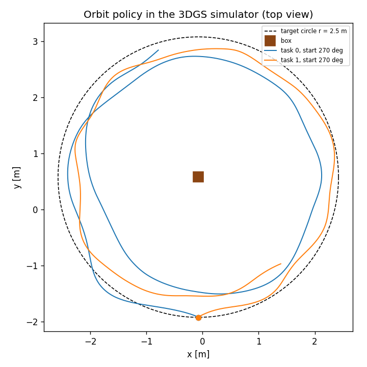
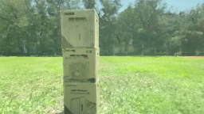

# Orbit-the-box policy

A trained GRaD-Nav++ vision-language policy that circles a stack of boxes in the [`sunny_baseball_field`](../scenes/sunny_baseball_field/README.md) scene: radius 2.5 m, flight-controller height 1.0 m, 0.5 m/s, nose (camera) always on the box. The language instruction picks the direction — task 0 clockwise, task 1 counter-clockwise, seen from above. Every 0.05 s (20 Hz) it reads one RGB camera image plus height, attitude and velocity, and outputs body rates and thrust.

This folder has the weights' loader and inference code — the same code that runs on the drone's Jetson — and a script that flies the policy, closed loop, in the 3DGS simulator it was trained in.

 

*Left: two episodes in the simulator, top view (`run_in_sim.py --out-dir`). Right: what the policy sees, 256×144, 12 s into the clockwise episode.*

Two versions are published. Both complete a full lap in every simulator episode below; they differ in the simulator they were trained in:

| | v4 (default) | v2 |
|---|---|---|
| Weights | [`orbit-policy-v4`](https://github.com/JeremyHo1123/drone-3dgs-nav/releases/tag/orbit-policy-v4) → `orbit_policy/bundle_v4/` | [`orbit-policy-v2`](https://github.com/JeremyHo1123/drone-3dgs-nav/releases/tag/orbit-policy-v2) → `orbit_policy/bundle_v2/` |
| Trained | 2026-10-29, with the real drone's command latency and motor response, plus a height integrator | 2026-09-27, in the ideal simulator (a command acts in the same step) |
| Real drone | Deployed, not flown yet | Oscillated up and down within 1–2 s on its first real flight (2026-10-19), see [v2](#the-v2-policy) |

Everything below is about v4 unless it says v2; [The v2 policy](#the-v2-policy) has v2's numbers and commands.

## Results in the simulator

From `run_in_sim.py` with its defaults (start south of the box, nominal airframe, the command-latency model it was trained with):

| | Clockwise | Counter-clockwise |
|---|---|---|
| One full lap | 25.1 s | 31.8 s |
| Height error, RMS | 2.3 cm | 3.0 cm |
| Radius error, RMS | 37.6 cm | 23.7 cm |
| Nose off the box, mean | 6.5° | 3.5° |
| Largest \|vertical speed\| after 2 s | 0.14 m/s | 0.21 m/s |

The radius error is real, not a measurement artefact: the policy flies on the inside of the circle. In the acceptance test before deployment — 16 randomised airframes and start points in each of nine latency / motor settings — it completed a lap in 16 of 16 episodes every time, with height RMS 3.0–3.7 cm and radius RMS 30–33 cm. In the harshest stress setting (longest delay, slowest motors, least thrust margin) height RMS rose to 5.4 cm.

**Real-drone status:** this checkpoint is deployed on the drone (Jetson Orin Nano + Pixhawk 6X, PX4 v1.17, MAVROS) but **has not flown yet**. An earlier version (v2) oscillated up and down on its first real flight because the simulator had no command latency; v3 and v4 were retrained with the latency and motor-response model that is now part of the simulator patch.

## What is here

| File | What it is |
|---|---|
| `orbit_runtime.py` | `OrbitPolicy`: loads `weights.pt`, builds the observation, runs the networks, returns the command. Needs only `torch` and `transformers` |
| `orbit_geometry.py` | Frames and geometry (scene ↔ ENU, the observation's yaw-free attitude and heading-frame velocity). No torch |
| `gradnav_models/` | The network definitions, copied from [grad_nav](https://github.com/Qianzhong-Chen/grad_nav) @ `95218ab` (SqueezeNet rewritten without torchvision) |
| `parity_check.py` | Replays `reference.pt` and checks that `OrbitPolicy` reproduces the training environment step by step |
| `run_in_sim.py` | Flies the policy in the simulator, closed loop, and reports orbit quality |
| `LICENSE-grad_nav.md` | The license of the grad_nav-derived parts (see "License" below) |
| [`../configs/grad_nav/`](../configs/grad_nav/README.md) | The simulator: a patch for grad_nav (environment, dynamics, latency model, camera, scene) |

The weights are in the [`orbit-policy-v4` release](https://github.com/JeremyHo1123/drone-3dgs-nav/releases/tag/orbit-policy-v4):

| File | Size | sha256 | Contents |
|---|---|---|---|
| `weights.pt` | 15 MB | `11a49b6297d86720aac0ff2155a7819816c6fedfd5c623a081190f21769637f2` | Plain tensors and settings (load with `weights_only=True`): actor, VAE, visual net, CLIP projection layers, observation normaliser, the two instructions' CLIP text embeddings, and `meta` (observation layout, simulator settings) |
| `reference.pt` | 38 MB | `781404bcd1769242acb3e61764821cad52e902f40935e1020d85ac5b71b4ba44` | Two 40-step runs recorded in the training environment, for `parity_check.py` |

The CLIP image encoder (`openai/clip-vit-base-patch16`, about 600 MB) is downloaded from Hugging Face on first use.

**Not published:** the training code — the changes to grad_nav's training algorithm, the training configs, and the training and acceptance scripts.

## Quick check, no simulator needed

Needs Python with `torch` and `transformers`; a GPU is optional.

```bash
gh release download orbit-policy-v4 -R JeremyHo1123/drone-3dgs-nav --dir orbit_policy/bundle_v4
cd orbit_policy
python parity_check.py            # add --device cpu without a GPU
```

Without the GitHub CLI, download [`weights.pt`](https://github.com/JeremyHo1123/drone-3dgs-nav/releases/download/orbit-policy-v4/weights.pt) and [`reference.pt`](https://github.com/JeremyHo1123/drone-3dgs-nav/releases/download/orbit-policy-v4/reference.pt) into `orbit_policy/bundle_v4/`.

It should end with `PASS`. On an RTX PRO 6000 the largest difference in the command sent to the flight controller was 3.7e-6 (tolerance 1e-3).

The `LOAD REPORT` table that `transformers` prints, with many `UNEXPECTED` rows, is expected: only CLIP's image half is loaded; its text half is not needed because the two instructions' text embeddings are stored in `weights.pt`.

## Run it in the simulator

Run everything from the repository root. You need a CUDA GPU and the `droneenv` environment from the top-level [README](../README.md), section 1. The simulator renders a 3DGS scene with nerfstudio + gsplat, so this is the same setup used to build the scenes.

**1. grad_nav at the right commit, plus the simulator patch**

```bash
mkdir -p repos
git clone https://github.com/Qianzhong-Chen/grad_nav.git repos/grad_nav
git -C repos/grad_nav checkout 95218ab
git -C repos/grad_nav apply --whitespace=nowarn ../../configs/grad_nav/grad_nav_simulator_v4.patch
```

**2. The scene.** Download the `sunny_baseball_field` checkpoint and lay it out under `scenes/sunny_baseball_field/workspace/` exactly as in [its README](../scenes/sunny_baseball_field/README.md), "Option B", steps 1 and 2. Then link it into grad_nav:

```bash
mkdir -p repos/grad_nav/envs/assets/gs_data repos/grad_nav/envs/assets/point_cloud
ln -s "$PWD/scenes/sunny_baseball_field/workspace/outputs"              repos/grad_nav/envs/assets/gs_data/outputs
ln -s "$PWD/scenes/sunny_baseball_field/workspace/sunny_baseball_field" repos/grad_nav/envs/assets/gs_data/sunny_baseball_field
```

**3. The obstacle point cloud** (the environment loads it for the obstacle reward; the policy never sees it):

```bash
python tools/prepare_pointcloud.py --in scenes/sunny_baseball_field/sunny_baseball_field_dense.ply \
  --out repos/grad_nav/envs/assets/point_cloud/sunny_baseball_field.ply \
  --crop-center -0.077 0.575 --crop-radius 12 --min-neighbors 5 --neighbor-radius 0.10 --percentile 0 --num-envs 256
```

It should report `Final 77,751 points`. This is the exact cloud used in training (checked byte for byte).

**4. The weights**, if you skipped the quick check:

```bash
gh release download orbit-policy-v4 -R JeremyHo1123/drone-3dgs-nav --dir orbit_policy/bundle_v4
```

**5. Fly**

```bash
python orbit_policy/run_in_sim.py
```

Expected output (about 40 s including start-up):

```
task 0 (clockwise), start 270 deg: flew 35.0 s, one lap in 25.1 s; radius err 37.6 cm rms, height err 2.3 cm rms, nose off box 6.5 deg, speed 0.58 m/s, |vz| max 0.14 m/s; cmd diff 1.4e-08; 11 s wall
task 1 (counter-clockwise), start 270 deg: flew 35.0 s, one lap in 31.8 s; radius err 23.7 cm rms, height err 3.0 cm rms, nose off box 3.5 deg, speed 0.47 m/s, |vz| max 0.21 m/s; cmd diff 8.6e-09; 11 s wall
largest command difference between deployment code and simulator: 1.4e-08  (OK)
```

`cmd diff` compares the command computed by `orbit_runtime.py` with the command the simulator computed from the same action. They are separate implementations of the same formulas, so anything above about 1e-4 means the policy is not getting the inputs it was trained on. The exact numbers depend on the GPU and library versions; on another machine expect small differences, not a different picture.

If `import envs` fails on a `rclpy` or ROS package, a ROS 2 `PYTHONPATH` has leaked into the environment: see section 1.2 of the top-level README.

### Options

```bash
python orbit_policy/run_in_sim.py --start-deg 0 90 180 270 --dr --out-dir runs/orbit_sim --video
```

| Option | Default | Meaning |
|---|---|---|
| `--bundle` | `orbit_policy/bundle_v4` | Folder with `weights.pt`; `orbit_policy/bundle_v2` for v2 |
| `--tasks 0 1` | both | 0 = clockwise, 1 = counter-clockwise |
| `--start-deg ...` | `270` | Start bearings on the circle, degrees from the box centre (0 = +x of the scene, counter-clockwise positive). One episode per bearing and task. The policy was trained from all bearings |
| `--steps` | `700` | Steps per episode (0.05 s each; 700 = 35 s, about 1.1 laps). The policy only knows how to keep orbiting: stopping after a lap, take-off and landing are done by the onboard program on the drone |
| `--latency cfg\|off` | `cfg` | `cfg`: the command-latency and motor-response model from training (delay, jitter, motor time constants and thrust curve drawn at random per episode; v2 was trained without one, so for v2 `cfg` means none). `off`: commands act immediately |
| `--dr` | off | Randomise mass and maximum thrust per episode, as in training |
| `--seed` | `0` | Same seed, same machine → identical episodes |
| `--out-dir`, `--video` | — | Write `metrics.json` (per-episode numbers and trajectories), `top_view.png`, and with `--video` the onboard camera as MP4 |

## The v2 policy

v2 is the first version that completes a full lap (v1, not published, never did: it flew 15 cm low at under half the target speed and got stuck east of the box). It was trained in the simulator with the same scene, task and reward as v4, but **without** the command-latency model, the height integrator and the deployment-style episode start, which all came later.

| File (release [`orbit-policy-v2`](https://github.com/JeremyHo1123/drone-3dgs-nav/releases/tag/orbit-policy-v2)) | Size | sha256 |
|---|---|---|
| `weights.pt` | 15 MB | `f5c13ad40b884704e572d7c4047c9faa7ba8bd6128f0b08d4deda66bc75225fd` |
| `reference.pt` | 38 MB | `4d227569c2c36c10cc5ea3808c066fd219e8e077676b64ea63fbdc66052b53b3` |

It uses the same code and the same simulator patch; only the folder changes:

```bash
gh release download orbit-policy-v2 -R JeremyHo1123/drone-3dgs-nav --dir orbit_policy/bundle_v2
(cd orbit_policy && python parity_check.py --bundle bundle_v2)      # PASS; largest command difference 2.8e-6 here
python orbit_policy/run_in_sim.py --bundle orbit_policy/bundle_v2
```

Expected output of the last command:

```
task 0 (clockwise), start 270 deg: flew 35.0 s, one lap in 28.1 s; radius err 41.3 cm rms, height err 4.5 cm rms, nose off box 4.4 deg, speed 0.49 m/s, |vz| max 0.21 m/s; cmd diff 0.0e+00; 10 s wall
task 1 (counter-clockwise), start 270 deg: flew 35.0 s, one lap in 29.6 s; radius err 30.7 cm rms, height err 3.6 cm rms, nose off box 3.6 deg, speed 0.49 m/s, |vz| max 0.20 m/s; cmd diff 0.0e+00; 10 s wall
largest command difference between deployment code and simulator: 0.0e+00  (OK)
```

Side by side, each in the simulator it was trained in, 8 episodes each (`--start-deg 0 90 180 270 --dr`: four start points, both directions, randomised mass and thrust):

| | v2 (no latency) | v4 (with its latency model) |
|---|---|---|
| Full lap | 8 / 8, in 27.8–29.8 s | 8 / 8, in 24.6–31.8 s |
| Height error, RMS | 2.5–6.6 cm | 1.6–6.4 cm |
| Radius error, RMS | 31–45 cm | 21–42 cm |
| Nose off the box, mean | 3.1–7.0° | 2.0–7.6° |
| Largest \|vertical speed\| after 2 s | 0.16–0.22 m/s | 0.10–0.26 m/s |

**Do not expect v2 to fly like this on a real drone.** On its first real flight it oscillated up and down with a period of about 0.9 s, growing each cycle, until the onboard safety check stopped it after 1.3 s and 0.85 s. The cause is the delay its training simulator did not have: about 55 ms from measuring the state to PX4 receiving the command, plus the motors' own response time (20–40 ms speeding up, 60–150 ms slowing down): v2 learned very strong height corrections that are only stable without delay. With the delays measured on that flight added to the simulator, all 16 of 16 simulated drones oscillated the same way. That is why v4 was trained with `LATENCY_MODEL`. To see v2 fail, it would have to run with v4's latency settings; `run_in_sim.py` does not do that (it always uses the settings the bundle was trained with).

For use outside the simulator, v2 takes `OrbitPolicy("bundle_v2")` with the default `T_hover=0.65, thrust_exponent=1.67` (its bundle does not record them).

## Using the policy outside this simulator

```python
from orbit_runtime import OrbitPolicy, SceneState

pol = OrbitPolicy("bundle_v4", instruction=0, T_hover=0.65, thrust_exponent=1.3)   # v4 requires these two values; v2: OrbitPolicy("bundle_v2")
pol.reset(state, image)          # at hand-over
while flying:
    cmd = pol.act()              # cmd.body_rate_flu (rad/s), cmd.sim_thrust_frac, cmd.px4_thrust
    ...                          # apply it for 0.05 s
    pol.observe(state, image)
```

- `state = SceneState(z, quat, vel)` in the scene frame (origin at the ArUco tag, +z up, metres): flight-controller height above the ground, attitude quaternion `(x, y, z, w)` from body FLU (forward, left, up) to the scene, and world-frame velocity. The policy does not see x/y position; it uses the image to know where the box is. Its attitude and velocity inputs are yaw-free, so the world yaw does not need to be aligned.
- `image`: RGB, float in [0, 1], shape `(144, 256, 3)`. The training camera is the drone's Orbbec Gemini 2 colour camera at 640×360 (fx 344.704, fy 344.737, cx 319.146, cy 180.512), mounted level 9.1 cm ahead of the flight controller; `prepare_camera_image()` reduces a 640×360 frame to 256×144.
- `cmd.body_rate_flu` and `cmd.sim_thrust_frac` (fraction of the simulator's maximum thrust, 0–0.5) are what the simulator consumes. `cmd.px4_thrust` converts it to a PX4 throttle for this drone (`T_hover × (f / f_hover)^(1/p)`); on another airframe that conversion has to be redone.
- The policy only learned to orbit from near-hover on the circle. Training episodes started within ±0.3 m of a point on the circle (in x, y and height), with up to ±7.5° tilt and ±0.25 m/s, nose on the box.

## License

`gradnav_models/`, the simulator patch in `configs/grad_nav/`, and the weights are derived from [grad_nav](https://github.com/Qianzhong-Chen/grad_nav), which is under the **NVIDIA Source Code License** ([`LICENSE-grad_nav.md`](LICENSE-grad_nav.md)): **non-commercial use only — research or evaluation**. The CLIP model is downloaded from Hugging Face under its own license. The rest of this folder is the author's own work.
